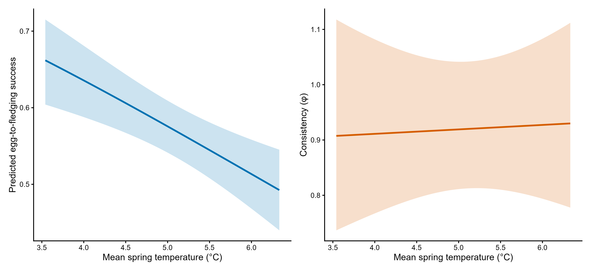
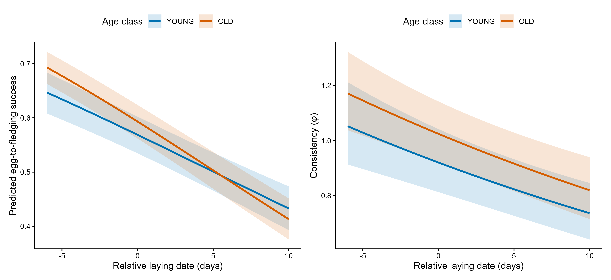
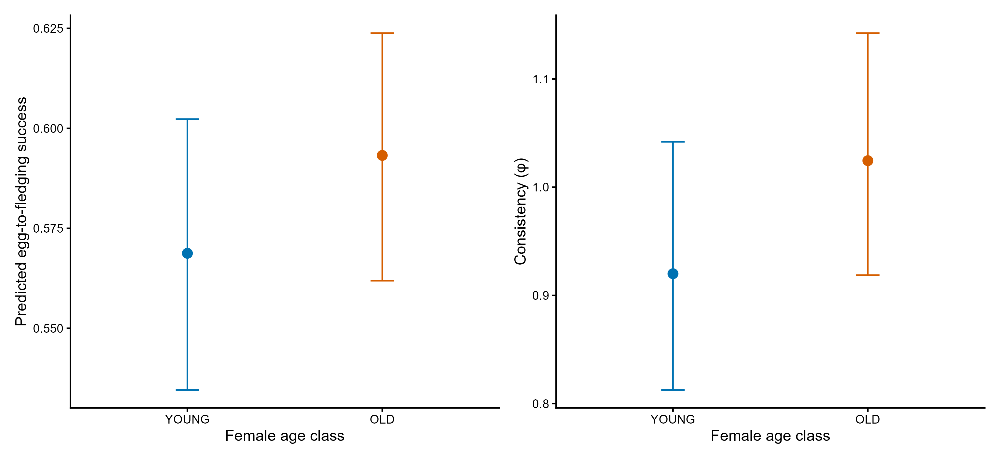
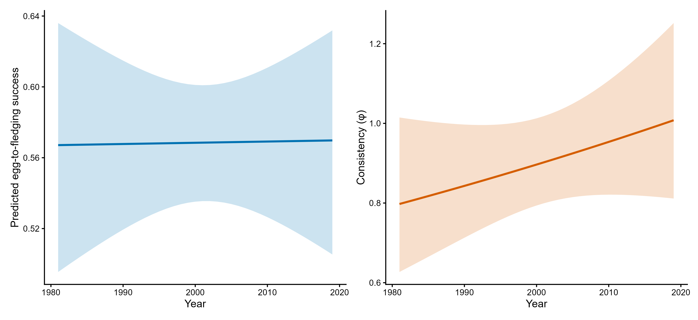

```{r}
#| include: false
invisible(Sys.setlocale("LC_CTYPE", "English_United States.utf8"))
.libPaths(c(".Rlib", .libPaths()))
library(readr); library(dplyr); library(knitr)
co <- read_csv("tables/fledging_bb_main_coefficients.csv", show_col_types = FALSE)
comparison <- read_csv("tables/fledging_bb_precision_comparison.csv", show_col_types = FALSE)
```

## Data and reference model

The analysis includes 9,790 broods from 7,132 females in 39 seasons (1981–2019), including 2,315 complete failures (23.65%). The paired response is fledged and failed eggs, so the mean describes egg-to-fledging success, including complete failures.

Location contains relative laying date, age, their interaction, temperature and calendar year, with year and female random intercepts. Log precision contains relative date, age, temperature and calendar year, with a year random intercept. Annual temperature is shared by broods in the same year, and annual heterogeneity is allowed in both components, paralleling the clutch-size model. The two year effects are independent. Higher phi indicates lower extra-binomial heterogeneity at a given mean and clutch size; it describes breeding attempts, not within-female repeatability.

## Fixed precision predictors with the same random structure

The null model has no fixed precision slopes but retains a year random intercept in precision and the identical location structure. The new LRT is chi-square = 39.9741 with 4 df, p = 4.382 × 10⁻⁸; AIC decreases by 31.9741. This supports the predictors jointly, not the temperature coefficient specifically.

```{r}
#| echo: false
kable(comparison, digits = 5, caption = "Matched-year-random-structure precision comparison")
```

## Temperature

Warmer springs were associated with lower mean success: beta_temp^(mu) = −0.2514 on the logit scale per °C, 95% CI [−0.3829, −0.1199], p < 0.001. There was no clear temperature association with consistency: beta_temp^(phi) = 0.0088 on the log-phi scale per °C, 95% CI [−0.0973, 0.1148], p = 0.871.

```{r}
#| echo: false
#| fig-cap: "Reference beta-binomial predictions with year random effects in both components. Left: mean egg-to-fledging success. Right: precision phi. Random effects are set to zero; bands are pointwise 95% CIs constructed on the link scale and back-transformed. They are not predictive bands."

```

## Relative date and female age

Later breeding was associated with lower mean success and lower precision. The mean date–age interaction was −0.0181 (95% CI [−0.0328, −0.0035], p = 0.015). Location slopes were -0.0547 for yearlings and -0.0729 for older females, on the logit scale per day. The precision slope was −0.02235 per day (95% CI [−0.03091, −0.01380], p < 0.001). Date and age enter precision additively.

Older females had higher mean success at relative date zero (beta_age^(mu) = 0.1006, 95% CI [0.0256, 0.1755], p = 0.009) and higher precision (beta_age^(phi) = 0.1075, 95% CI [0.0151, 0.1999], p = 0.023). These contrasts were uncertain in the zero-augmented sensitivity fit.

```{r}
#| echo: false
#| fig-cap: "Reference predictions against relative date, with year and female random effects set to zero. Bands are pointwise 95% CIs; date slopes in log precision are shared by the two age classes."

```

```{r}
#| echo: false
#| fig-cap: "Reference predictions by female age at centred continuous predictors and zero random effects. Error bars are pointwise 95% CIs."

```

## Calendar year and random effects

Calendar year had no clear additional association with either component after temperature was accounted for: location beta_time = 0.00028 on the logit scale (95% CI [−0.01229, 0.01286], p = 0.965); precision beta_time = 0.00615 on the log-phi scale (95% CI [−0.00406, 0.01637], p = 0.238). Random-intercept SDs were 0.363 for year and 0.237 for female in location and 0.271 for year in log precision. They are conditional model quantities, not a total phenotypic-variance decomposition.

```{r}
#| echo: false
#| fig-cap: "Conditional reference predictions through time, holding temperature and relative date at their centred values and random effects at zero; bands are 95% CIs."

```

## Full coefficient table

```{r}
#| echo: false
kable(co |> select(component, term, beta, SE, CI_low, CI_high, p), digits = 5, caption = "Reference coefficients: location on logit scale, precision on log-phi scale, with Wald 95% CIs")
```

## Complete-failure calibration and distributional sensitivity

We assessed reproduction of the complete-brood-failure frequency using simulation-based predictive checks (Supplementary Methods S1.10). We assessed sensitivity to excess zeros using a zero-augmented beta-binomial model with the same fixed and random effects (S1.12).

<details>
<summary>Numerical results of the two checks</summary>

The reference underestimated the observed 23.65% complete-failure fraction: fitted-mode simulations gave 20.07% (95% envelope [19.26, 20.84]); new-group simulations gave 19.21% [16.67, 22.15]. With approximate joint parameter uncertainty, the envelope widened to [15.89, 23.35]%, still below the observation at its upper limit. These checks omit conditional group-mode uncertainty and are not formal goodness-of-fit tests.

A zero-augmented sensitivity fit retained year effects in both components and reduced AIC by 740.78. Its precision-temperature coefficient was uncertain (−0.0854, CI [−0.2614, 0.0905]), while its conditional location coefficient remained negative (−0.2755, CI [−0.4184, −0.1325]). Approximate parameter uncertainty gave a zero-frequency envelope [19.92, 23.85]%. The mixing probability 0.1695 is not an identified biological fraction of failures; global coverage does not validate the full distribution.

```{r}
#| echo: false
kable(read_csv("tables/fledging_zero_calibration_audited.csv", show_col_types = FALSE), digits = 5, caption = "Audited zero-frequency simulation fractions for the reference and zero-augmented models")
```

</details>

## Workflow and downloads

Run [R/67_fledging_reference_year_precision.R](R/67_fledging_reference_year_precision.R), [R/68_export_fledging_year_precision_reference.R](R/68_export_fledging_year_precision_reference.R) and [R/69_window_sensitivity_year_precision.R](R/69_window_sensitivity_year_precision.R). Individual field records and model caches are author-held inputs; public files contain aggregate outputs.

- [Precision comparison](tables/fledging_bb_precision_comparison.csv)
- [Reference coefficients](tables/fledging_bb_main_coefficients.csv)
- [Mean temperature predictions](tables/fig5_1_success_temperature.csv)
- [Precision temperature predictions](tables/fig5_1b_phi_temperature.csv)
- [Calendar-window sensitivity](tables/window_sensitivity_fledging.csv)
- [Zero-frequency checks](tables/fledging_zero_calibration_audited.csv)
- [Parameter-uncertainty checks](tables/fledging_zero_parameter_uncertainty_audited.csv)
